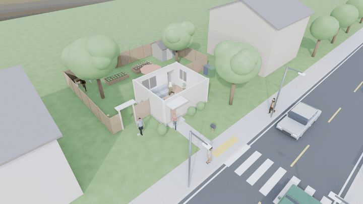
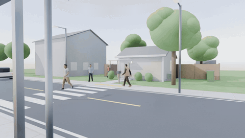
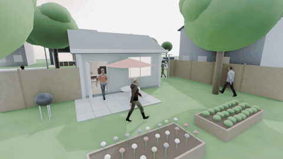
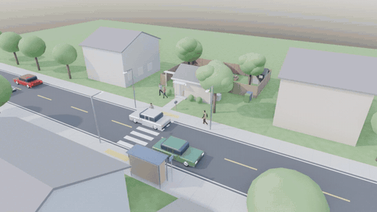
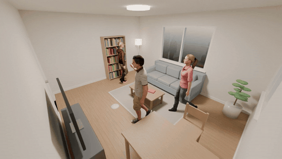
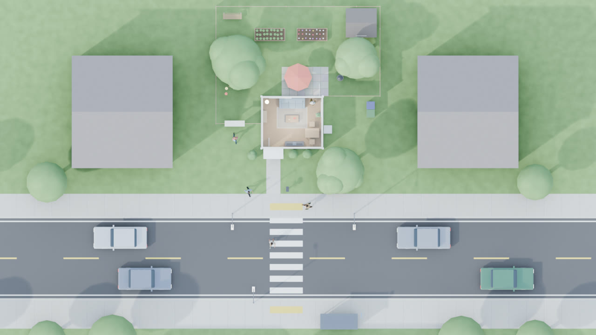
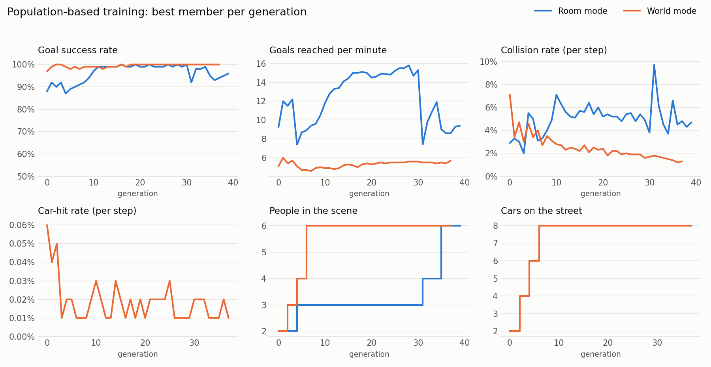

# human-centric-world-simulation: digital humans learning to live in a 3D world

<p align="center">
  
  <br>
  <sub>Six learned walking policies share a house, a garden and a street with eight cars: they go through the doors and the
  garden gate, cross at the zebra crossing, and the cars brake for them. Roof cut away; rendered in Blender (EEVEE).
  <a href="docs/media/world_cutaway.mp4">Full video</a></sub>
</p>

Several digital humans share a 3D world built in Blender: a furnished house, its back garden,
the front yard, and a street with moving cars, a zebra crossing and a bus stop. Their walking
policies are trained in PyTorch with PPO across two GPUs. A *recursive self-improvement* loop
improves them generation by generation: population-based training, self-play against elite past
policies, distillation of the best policies into new students, and an automatic curriculum.
The learned trajectories go back into Blender, where photo-realistic Microsoft Rocketbox avatars
walk them with motion-captured gaits. Results are rendered as videos or saved as `.blend` and `.bvh` files.

## Demos
All clips are rollouts from trained checkpoints (no scripted paths): every person picks its own next goal, plans a route
and walks it; the motion-captured gait is time-scaled to the learned speed. Click a title for the full-length MP4.

| [Street crossing](docs/media/world_street.mp4) | [Back garden](docs/media/world_garden.mp4) |
|:---:|:---:|
|  |  |
| People use the zebra crossing; attentive drivers brake and wait (IDM car-following with pedestrian yielding). | Patio, vegetable and flower beds, bench and shed; the side gate links the garden to the street. |
| [**Aerial view**](docs/media/world_aerial.mp4) | [**Room mode** (Cycles)](docs/media/room_corner.mp4) |
|  |  |
| The whole lot: house, fenced garden, front yard, sidewalks, two-lane street and bus stop. | The original living-room task with photo-realistic Microsoft Rocketbox avatars, path-traced in Cycles. |

<p align="center">
  
  <br><sub>Top-down map (<code>--camera top</code>): the house is cut open, the garden is to the north and the street to the south.</sub>
</p>

Re-create all of these from your own checkpoints with `scripts/make_demo_media.sh` (about 45 min on 2× RTX A2000).

There are two modes, each with its own spec and training config:

| Mode | Spec | Training config | What the humans do |
|---|---|---|---|
| **World** | `configs/world.json` (includes `room.json`) | `configs/world.yaml` | Move between rooms, garden, yard and street: through doors and the garden gate, across the road at the crossing, around traffic |
| **Room** | `configs/room.json` | `configs/default.yaml` | Walk between furniture inside the living room only |

```
configs/room.json ──┬──────────────────► blender/build_room.py ──► assets/room.blend   (visuals, room mode)
                    │
configs/world.json ─┼──────────────────► blender/build_world.py ─► assets/world.blend  (visuals, world mode)
                    │
                    └► worldsim/room_spec.py + world_spec.py ──► worldsim/env.py  (GPU physics, same colliders;
                                                                   nav.py routes, traffic.py cars)
                                                                         │
train.py: PBT coordinator ── worker cuda:0 ──┐                           ▼
                         └── worker cuda:1 ──┴─► PPO + self-play + distillation ─► runs/<id>/best.pt
                                                                                        │
evaluate.py ─► renders/*.npz (humans + cars, + .bvh) ─► blender/render_rollout.py ─► .mp4 + animated .blend
```

## Quick start
```bash
./scripts/install_blender.sh                              # portable Blender 4.2 LTS -> tools/blender
python3 scripts/fetch_rocketbox.py                         # photo-realistic avatars + mocap (~540 MB, MIT)
tools/blender/blender -b -P blender/build_world.py         # assets/world.blend, world.glb, world_layout.json
tools/blender/blender -b -P blender/build_room.py          # assets/room.blend, room.glb, room_layout.json
tools/blender/blender -b -P blender/build_human.py         # assets/human.blend (simple mannequin rig, optional)

.venv/bin/python -m pytest -q tests                       # 17 tests (room + world)

# World: house + garden + street with traffic
.venv/bin/python train.py --config configs/world.yaml --smoke --generations 2   # ~1 min check on both GPUs
.venv/bin/python train.py --config configs/world.yaml --name world              # full run (~5 min/generation)
.venv/bin/tensorboard --logdir runs/world/tb                                    # per member, best, curriculum
.venv/bin/python train.py --resume runs/world --generations 120                 # continue later
.venv/bin/python evaluate.py --ckpt runs/world/best.pt --agents 4 --cars 6 --out renders/world.npz
tools/blender/blender -b -P blender/render_rollout.py -- --rollout renders/world.npz --camera cutaway

# Room only
.venv/bin/python train.py --name main                                           # configs/default.yaml
.venv/bin/python evaluate.py --ckpt runs/main/best.pt --agents 4 --out renders/rollout.npz --bvh
tools/blender/blender -b -P blender/render_rollout.py -- --rollout renders/rollout.npz --camera corner
```
`evaluate.py` prints a benchmark, then writes a rollout. It uses the spec and traffic level the checkpoint
was trained with unless you pass `--spec`, `--agents` or `--cars`.

**Render options**:
- `--camera`:
  - World: `cutaway` (default; roof off, house + garden + street), `aerial`, `street`, `garden`, `top`, `follow`.
  - Room: `corner` (default), `top`, `follow`.
- `--engine cycles|eevee`: Cycles is the default for Rocketbox humans; EEVEE is a fast preview.
- `--res 1920x1080`, `--samples 32`, `--frames 300`, `--still 120` (one PNG frame).
- `--humans rocketbox|mannequin` and `--avatars Female_Adult_01 Male_Adult_05 ...`: Rocketbox is used if it has been downloaded.

Each render also saves an animated `.blend` next to the video, so you can open it in Blender and scrub the timeline.

## The world (`configs/world.json`)
The world wraps the room in its surroundings. Coordinates continue from the room's: the origin
is the living room's inside south-west corner, the street is to the south (−y), and the garden is to the north (+y).

- **House**: the room's walls become solid colliders. The **front door** (south) and the **patio door**
  (north) are the only ways through, and both are drawn swung open, with their leaves as colliders.
  Outside, the house has siding, a gable roof, and a porch canopy with a light.
- **Back garden**: patio with table and umbrella, barbecue, vegetable and flower beds, two trees, a bench
  and a shed, all fenced. A **garden gate** with an arbour on the west side leads round to the front.
  The east side yard is a dead end with the bins.
- **Front**: path, porch step, shrubs, mailbox, a tree, and the sidewalk with street lamps.
- **Street**: two 3.5 m lanes with centre and edge markings, a zebra crossing in front of the house with
  tactile paving, and the far sidewalk with a **bus stop**. Neighbouring houses and street trees form the backdrop.
- **Cars** (`worldsim/traffic.py`):
  - They drive both lanes at 6–12 m/s, looping round off-screen. They follow each other using the
    Intelligent Driver Model and brake for people in or next to their lane ahead.
  - Braking is capped at 8 m/s², and a quarter of drivers are *distracted*: they only notice people
    within 7 m. Stepping out in front of a car is genuinely dangerous.
- **Goals**: 24 named places across the house, garden, yard and street (sofa, bookshelf, back door, patio table,
  garden bench, shed, bins, mailbox, bus stop, ...), or random reachable spots off the road.

**What the humans get in the world:**
- **Routes** (`worldsim/nav.py`):
  - **Route distances:** the world is divided into 0.25 m cells. The shortest walkable path between every
    pair of cells is computed on the GPU at start-up (wavefront relaxation, ~3 s, ~130 MB).
  - **Crossing preference:** road cells outside the crossing count as 4× longer, so routes use the zebra
    crossing unless the detour is long.
  - **Reward:** progress is measured along the *route*. Going from the sofa to the bus stop (23 m by route,
    17 m in a straight line) starts by walking away from it, towards the front door.
  - **Observation:** each human sees a waypoint about 1 m ahead on the route.
- **Traffic awareness**: cars appear in the lidar, and the 2 nearest cars' relative position and velocity
  are part of the observation, along with flags for being indoors, on the road, or on the crossing.
- **Penalties**:
  - Being hit by a car costs −10 per step in the reward and −300 × car-hit rate in the PBT fitness.
  - Walking on the road outside the crossing (jaywalking) costs −0.05 per step.

## Make it *your* place
Everything comes from the two JSON files. The physics the agents learn in and the Blender visuals
are both generated from them by the same code, so they always match.

**The room: `configs/room.json`**. Measure your room and edit:
- `width`, `depth`, `height`: interior size in metres. The origin is the inside south-west corner,
  x runs along the south wall, and y runs into the room.
- `openings`: doors and windows, each given as a wall, offset from the wall's start corner, width, height and sill.
  - Doors with `"open": "in"` or `"out"` and `"hinge": "left"` or `"right"` are drawn swung open.
  - In the world, door openings are the only way through a wall; windows are solid at walking height.
- `furniture`: for each piece:
  - `type`: sofa, table, chair, tv_stand, bookshelf, plant, lamp or rug (any other name gives a plain box).
  - `center` of the footprint, and `size` = [width, depth, height].
  - `rot`: 0 means the front faces south (−y).
  - `color`, and an optional `poi`: a goal point in front of the piece.
- `materials`, `lights`: floor, wall and ceiling colours, plus the sun direction.

**The surroundings: `configs/world.json`**:
- `bounds`: the walkable rectangle around the house.
- `objects`: garden and street furniture, using the same schema as room furniture. Types are patio, patio_table,
  bbq, tree (with `canopy` radius), shrub, garden_bed (with `flowers`), bench, shed, bins, mailbox, street_lamp,
  bus_stop, path, step and generic. Set `collide: false` for things you walk over.
- `fences`: straight runs `from` → `to`. Each `gates` entry is a gap in a run, with an offset along it and a width.
- `road`, `crosswalks`, `sidewalks`: axis-aligned rectangles.
- `traffic`: the lanes (`y`, `dir`), speed range, car size, driver behaviour and car colours.
- `nav`: the grid cell size and `road_cost`.
- `backdrop`: houses outside the walkable area (visual only).
- `extra_pois`: more named goals.

After editing, run `build_world.py` and/or `build_room.py`, which check that everything fits, and then retrain.
For photorealism indoors, pass a phone LiDAR scan of the real room via `render_rollout.py --room-scan scan.glb`
(Polycam, Scaniverse, etc., exported as `.glb` or `.obj` and aligned to the same origin). The scan replaces
the procedural visuals while the measured `room.json` stays the physics.

## Training results
<p align="center"></p>

Best population member per generation, on the fixed-seed evaluation (`scripts/plot_training.py`). Each step-up of
"people" or "cars" is the curriculum moving to a harder stage, which is why goals/min drops at those points in room mode.

| Mode (generation) | People | Cars | Success | Goals / min | Collision rate | Car-hit rate | Jaywalk rate |
|---|---|---|---|---|---|---|---|
| World (38) | 6 | 8 | 100% | 5.5 | 1.2% | 0.02% | 2.6% |
| Room (39) | 6 | – | 96% | 9.4 | 4.7% | – | – |

Goals per minute are lower in the world because the goals are much farther apart (routes of 10–25 m through doors, the
gate and the crossing, against 2–5 m inside the room).

## How it works
**Environment (`worldsim/env.py`)**: B worlds × N humans are simulated together as tensors on the GPU.
- **Bodies:** each human is a 0.25 m disc with unicycle dynamics (acceleration and turn-rate control, max 1.5 m/s).
- **Collisions:** contacts with rotated boxes (walls, furniture, fences, garden objects), other humans
  and cars are resolved every step. Cars are tested over their swept path, so a fast car can't pass through anyone.
- **Observations**:
  - Room: 43 numbers (16-ray 360° lidar, the goal in the body frame, own velocity, pose, and the 3 nearest humans).
  - World: 59 numbers, adding the route waypoint and distance, the indoor/road/crossing flags, and the 2 nearest cars.
- **Reward:** pays for progress and arrivals, and penalises bumps, personal-space intrusion (< 0.8 m),
  jerky control, and in the world, car hits and jaywalking.

**Policy and learning (`policy.py`, `ppo.py`)**:
- **Policy:** an actor-critic MLP with observation normalisation built in.
- **PPO:** with GAE; every human a member controls shares its policy.
- **Self-play:** in half of the worlds, the other humans are a *frozen opponent* (`selfplay.py`),
  drawn from the elite archive or the current population.

**Recursive self-improvement (`train.py`, `pbt.py`, `distill.py`)**: each generation:
1. Each of the 8 members trains with PPO (4 per GPU, one worker process per GPU).
2. Each member is scored on a fixed-seed benchmark:
   `score = goals/min × success − 80 × collision rate − 300 × car-hit rate`.
3. Exploit/explore: the bottom 25% copy the top 25%'s weights and mutate lr, entropy, clip,
   γ and λ. Sometimes the network width changes too, and the parent is then distilled into the new size.
4. The best policies enter an elite archive, where they become self-play opponents and teachers.
5. Every 5 generations, the worst member is reborn as a student distilled from the top-3
   elites (DAgger-style), and then keeps improving with RL.
6. Curriculum: once the best member clears the threshold, the next stage starts.

   | Mode | Threshold | Stages |
   |---|---|---|
   | Room | ≥ 90% success, ≤ 4% collisions, ≥ 6 goals/min | 2 → 3 → 4 → 6 humans |
   | World | ≥ 85% success, ≤ 4% collisions, ≥ 2.5 goals/min, ≤ 0.1% car-hit steps | 2 people + 2 cars → 3 + 4 → 4 + 6 → 6 + 8 |

   In both modes, goals also get farther apart at each stage.

Everything is checkpointed (`runs/<id>/gen_XXX/member_k.pt`, `state.json`, `history.jsonl`) and resumable.
The checkpoints record the spec and environment settings they were trained with.

**Photo-realistic digital humans (`blender/rocketbox.py`)**: [Microsoft Rocketbox](https://github.com/microsoft/Microsoft-Rocketbox)
avatars are rigged, textured, scan-quality characters under the MIT license. Six are fetched by default;
list more with `fetch_rocketbox.py --list` and add them with `--avatars`. They are animated with Rocketbox's own **motion capture**:
- **Root and limbs:** the trained policy drives each human's root (position and heading). The limbs come from
  mocap clips layered in Blender's NLA: `idle < walk_slow < walk_neutral < walk_fast`. The blend weights follow
  the policy's speed (0.8 / 1.0 / 1.5 m/s clips).
- **Feet stay planted:** all walk clips share one gait phase, which advances by *distance travelled ÷ stride length*.
  Clips are made in-place and phase-aligned automatically from the foot oscillation. Walking backwards plays the cycle in reverse.
- **Retargeting:** clip and avatar skeletons have different rest poses (arms-down vs T-pose). Each bone is retargeted
  with `q_avatar = (L_avatar⁻¹ · L_clip) · q_clip`, and root height is scaled to the avatar's body.
- **Materials:** rebuilt from the textures (colour, normal and specular maps, skin subsurface, alpha hair cards). Use Cycles for realism.

`--humans mannequin` uses the simple procedural rig instead (`build_human.py`, `skeleton.py`, `gait.py`).
`evaluate.py --bvh` writes that skeleton's motion as BVH, for retargeting onto other characters.

**Cars in Blender (`blender/cars.py`)**: procedural sedans (painted body, glass cabin, lights, mirrors,
spinning wheels), keyed from the rollout's car trajectories.

## Layout
```
configs/   room.json (the room), world.json (house + garden + street), default.yaml (room training), world.yaml (world training)
blender/   build_room.py, build_world.py, build_human.py, rocketbox.py, cars.py, render_rollout.py, common.py
worldsim/  room_spec, world_spec, layout, nav, traffic, sensors, env, gait, skeleton, policy, ppo, pbt, selfplay, distill, export
tests/     test_room.py (room, PPO, PBT, export), test_world.py (routes, crossing, traffic, car hits, world export)
scripts/   install_blender.sh, fetch_rocketbox.py, make_demo_media.sh (README media), plot_training.py
docs/media/  demo GIFs, MP4s, stills and training curves shown in this README
train.py   evaluate.py
```
Not in git (see `.gitignore`): `tools/` (Blender), `.venv/`, `runs/` (checkpoints), `renders/`, and `assets/rocketbox/`.
Re-create these with the quick-start commands.

## Notes
- Hardware: 2× RTX A2000 (6 GB).
  - Room mode: each worker peaks at about 0.6 GB, and a generation takes about 3 min (8 members × 40 updates × 1024 rooms).
  - World mode: about 300k human-steps/s per GPU (1024 worlds × 4 people with 6 cars, 1.2 GB), and a generation takes about 5 min.
- GPU utilisation is about 30% because the small simulation kernels are launch-bound. Raising `num_worlds`
  gives more samples nearly for free, and `torch.compile` or CUDA graphs on `env.step` is the next speed-up.
- Room and world policies aren't interchangeable, because their observations differ (43 vs 59 numbers).
- `download.blender.org` blocks scripted downloads, so the installer falls back to official mirrors and checks SHA-256.
